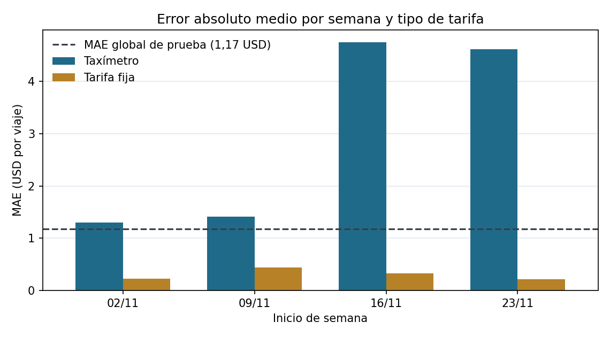
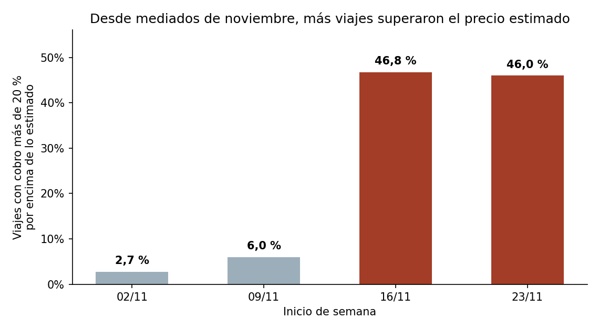

# Semana 14, Sesión 2: Comunicación técnica y ejecutiva de los resultados

> Objetivo de la sesión: adaptar la presentación de los resultados y limitaciones de tu proyecto a una audiencia técnica y a una audiencia ejecutiva.

**Lectura previa de esta sesión:** ["How to Effectively Communicate Results to Stakeholders As a Data Scientist"](https://medium.com/@sahin.samia/how-to-effectively-communicate-results-to-stakeholders-as-a-data-scientist-711e88dd464f), Sahin Samia.

**Referencia de esta sesión:** *Designing Machine Learning Systems*, Cap. 11: The Human Side of Machine Learning.

## Requisitos antes de esta sesión

Nada nuevo que instalar. Hoy se escribe más de lo que se programa: los dos scripts preparan los números y los gráficos, y el trabajo es decidir qué se dice a quién.

## Antes de empezar

A partir de la lectura previa:

**Según el artículo, ¿qué hay que saber de la audiencia antes de preparar la presentación? ¿Qué recomienda hacer con la jerga técnica?**

Hay que conocer su formación técnica, sus prioridades y la decisión que necesita tomar. Presentaría el método y las métricas al equipo de datos. Para gerencia traduciría esos resultados a casos, tiempo o dinero y explicaría cualquier término técnico indispensable con palabras de uso habitual. [Lectura sobre comunicación con stakeholders](https://medium.com/@sahin.samia/how-to-effectively-communicate-results-to-stakeholders-as-a-data-scientist-711e88dd464f)

**¿Qué lugar le da el artículo a las limitaciones y a la incertidumbre de los resultados?**

La audiencia necesita saber qué supuestos sostienen el resultado, qué límites tienen los datos y cuánta confianza merece la conclusión. Explicaría cómo esas condiciones afectan la decisión y dejaría el detalle metodológico en un apéndice técnico. [Lectura sobre comunicación con stakeholders](https://medium.com/@sahin.samia/how-to-effectively-communicate-results-to-stakeholders-as-a-data-scientist-711e88dd464f)

## Pregunta de apertura

¿Qué cambia entre explicarle tu proyecto a otro científico de datos y a quien paga la factura? Escribe la primera oración que le dirías a cada uno.

- **Científico de datos.** «El bosque estima el volumen de emergencias por cantón a tres días con un MAE de 5,63 en la prueba temporal».

- **Responsable del presupuesto.** «Propongo probar el pronóstico para revisar con tres días de anticipación qué cantones podrían necesitar más cobertura».

## Ejercicio 1: noviembre, para dos audiencias

Carpeta: [`starter/ejercicio1/`](./starter/ejercicio1/). [`tarifas_noviembre.csv`](./starter/ejercicio1/tarifas_noviembre.csv) tiene los 1156 viajes de noviembre del monitoreo de la Semana 13: la tarifa estimada por la versión 1, la cobrada y si el viaje tenía tarifa fija. [`graficos_tarifa.py`](./starter/ejercicio1/graficos_tarifa.py) calcula el resumen por semana y dibuja dos gráficos con los mismos datos, `grafico_tecnico.png` y `grafico_ejecutivo.png`. Los 3 `TODO`: el resumen, el gráfico técnico y el gráfico ejecutivo.

```
python graficos_tarifa.py
```

**Respuesta 1 (TODO 1):** el MAE pasó de 1.18 a 4.29. Antes de calcularlo: ¿qué número de la tabla le dirías a la gerente de operaciones, que nunca oyó hablar del MAE?

Le diría la proporción de viajes cuyo cobro superó por más de un 20 % el precio estimado. La tabla mostró que pasó del **2,7 %** en la semana del 2 de noviembre al **46,8 %** en la del 16, cuando ocurrió en 144 de 308 viajes.

**Respuesta 2 (TODO 2 y 3):** los dos gráficos usan los mismos viajes. Haz una lista de todo lo que cambia entre uno y otro: la métrica, el título, la cantidad de series, los colores.

- **Métrica.** El técnico muestra MAE en USD por viaje y una referencia de 1,17 USD. El ejecutivo muestra el porcentaje de viajes cuyo cobro superó en más de un 20 % la estimación.
- **Título.** El técnico identifica la medida y el desglose por tarifa. El ejecutivo comunica que desde mediados de noviembre aumentó la proporción de cobros por encima de lo estimado.
- **Series.** El técnico tiene dos series de barras, una línea de referencia y una leyenda. El ejecutivo tiene una sola barra por semana con el porcentaje encima.
- **Colores.** El técnico usa azul para taxímetro, ocre para tarifa fija y gris oscuro para la referencia. El ejecutivo usa gris azulado para las primeras dos semanas y terracota para las dos últimas.

**Respuesta 3:** escribe las dos diapositivas. Cada una tiene un título que es una oración completa, el gráfico y como máximo cuatro líneas.

**Diapositiva técnica** (para el equipo de datos):

### El error aumentó desde el 16 de noviembre en los viajes con taxímetro.



- Se midió el MAE de la versión 1 en los 1.156 viajes de noviembre.
- Se comparó cada estimación con su cobro y se agrupó por semana y tipo de tarifa.
- En taxímetro, el MAE pasó de USD 1,41 a USD 4,75 del 9 al 16. En tarifa fija bajó de USD 0,44 a USD 0,32.
- El análisis de un mes localiza el deterioro. Confirmar su causa requiere verificar la regla tarifaria vigente.

**Diapositiva ejecutiva** (para la gerente de operaciones):

### Casi la mitad de los viajes de la semana del 16 costó más de un 20 % sobre lo estimado.



- En esa semana, 144 de 308 viajes superaron la estimación en más de un 20 %.
- La diferencia media entre cobro y estimación fue de USD 4,23 por viaje esa semana.
- Recomendamos verificar la tarifa vigente y actualizar la estimación del taxímetro.
- Pedimos a Operaciones que asigne un responsable y facilite la tabla tarifaria y los cobros recientes.

## Durante el ConcepTest

**Tu voto, antes de discutir en pareja** (A, B, C o D):

El material del laboratorio no incluye el enunciado ni las opciones. La letra del voto queda pendiente.

**Tu razonamiento:**

Con el caso de tarifas, para Operaciones elegiría el mensaje que cuantifica cuántos viajes superan el precio estimado y pide una acción concreta. Para el equipo de datos conservaría el desglose por tipo de tarifa y la comparación con la prueba.

**Después de discutir en pareja, ¿cambiaste de voto? ¿Por qué?**

La discusión en pareja queda pendiente.

## Ejercicio 2: el fraude, en dólares

Solo o en pareja. Carpeta: [`starter/ejercicio2/`](./starter/ejercicio2/). El reporte técnico de la Semana 13 decía que el recall de la semana del 16 cayó de 0.74 a 0.28. [`costos_fraude.py`](./starter/ejercicio2/costos_fraude.py) lo traduce a dólares con los costos de la Semana 11 (40 por fraude no detectado, 3 por revisar un pago legítimo). Los pasos 1 a 3 tienen `TODO`: los errores por semana, su costo y el costo de una semana normal. Los pasos 4 (la oración para la gerencia) y 5 (lo que cuesta un mes así) solo tienen un comentario. Resuelve y corre `python comprobar.py` hasta que los cinco pasos digan `OK`; después, `python costos_fraude.py`.

**Respuesta 1:** ¿qué oración te dio el paso 4? ¿Qué le falta para que la gerente pueda decidir algo?

> La semana del 2026-11-16, el fraude que no detectamos y las revisiones costaron 2359 dolares, 2.7 veces una semana normal.

Falta indicar la acción recomendada, qué decisión se solicita y cuánto cuesta demorarla. También falta aclarar que la cifra se estimó con costos unitarios supuestos.

**Respuesta 2:** escribe el mensaje ejecutivo completo, en cinco oraciones como máximo: qué pasó, cuánto cuesta, qué recomiendan, qué necesitan y qué riesgo queda.

La semana del 16 de noviembre quedaron sin detectar 55 de 76 fraudes confirmados. Con USD 40 por fraude omitido y USD 3 por revisión de un pago legítimo, estimamos un costo de USD 2.359 frente a USD 867 en una semana normal y un aumento de USD 5.968 si el deterioro dura cuatro semanas. Recomendamos probar con un cupo limitado más revisiones manuales de los pagos cercanos al umbral, registrando fraudes detectados y revisiones de pagos legítimos. Pedimos a la gerente que autorice el cupo piloto y acuerde con Finanzas los costos por caso. Hasta 21 días de demora en las confirmaciones pueden ocultar el efecto inicial del piloto.

**Respuesta 3:** el costo de 40 dólares por fraude no detectado es una suposición de la Semana 11. ¿Dónde lo dirías, en el mensaje ejecutivo o en el técnico? ¿Qué pasa con tu recomendación si el costo real fuera la mitad?

En el mensaje ejecutivo lo mencionaría como supuesto de la cifra de impacto. En el técnico dejaría el cálculo reproducible con USD 40 por fraude omitido y USD 3 por revisar un pago legítimo. Si el primer costo baja a USD 20, la semana del 16 costaría USD 1.259 frente a USD 507 de referencia y la diferencia de cuatro semanas sería **USD 3.008**. Mantendría la investigación y condicionaría cualquier ampliación de revisiones a que el ahorro esperado supere su costo adicional.

## Ejercicio 3: los resultados de tu proyecto, dos veces

Usa tu proyecto en [`psets/proyecto/`](../../psets/proyecto/README.md). Esta vez no hay plantilla.

### Entregable 1: `docs/resultados_tecnico.pdf`

Una diapositiva para otra persona del equipo de datos: el modelo y la línea base, la métrica de la Semana 11 con su esquema de validación, lo que mostró el monitoreo y las limitaciones, con los números.

[Diapositiva técnica de ECU911](../../psets/proyecto/docs/resultados_tecnico.pdf)

### Entregable 2: `docs/resultados_ejecutivo.pdf`

La misma diapositiva para quien decide si se usa el modelo: un título que dice la conclusión, el resultado en la unidad de quien decide (dinero, tiempo, casos), qué recomiendan, qué necesitan y qué no hace el modelo. Sin el nombre del algoritmo ni de la métrica.

Puedes armar las dos diapositivas en lo que prefieras (Google Slides, PowerPoint, Markdown exportado) y guardarlas en PDF.

[Diapositiva ejecutiva de ECU911](../../psets/proyecto/docs/resultados_ejecutivo.pdf)

**¿Qué número de tu proyecto usaste en la versión ejecutiva que no aparece en la técnica? ¿De dónde salió?**

Usé **31 emergencias menos de diferencia media por cantón y día** frente a la cifra histórica fija. Resté 5,632802 a 36,630104 en la misma prueba temporal y redondeé 30,997302 a 31. Es una reducción del error del pronóstico.

**¿Qué limitación dejaste en las dos versiones, y cómo la dijiste en cada una?**

En la técnica expliqué que el objetivo es el volumen diario y que las alertas de demanda alta requieren validación propia. En la ejecutiva dije que el pronóstico estima el total de emergencias por día y que cualquier alerta de demanda alta debe probarse por separado.

## Antes de la próxima sesión

**Lectura:** ["AI Model Lifecycle Management: From Development to Decommissioning"](https://blog.cognitiveview.com/ai-model-lifecycle-management-from-development-to-decommissioning/), CognitiveView.

Hoy escribiste "qué no hace el modelo" en una diapositiva. Ahora imagina que sí lo hace mal: ¿bajo qué condición apagarías el modelo de tu proyecto, y quién tendría que enterarse?

Suspendería el uso operativo si el error medio superara **7,73 emergencias por cantón y día** durante dos semanas completas consecutivas, con al menos **95 %** de cobertura del conteo observado en cada semana. Volvería temporalmente a la planificación habitual, documentaría la versión y la evidencia, y avisaría a la jefatura de Operaciones, al equipo de planificación y a quienes mantienen los datos y el servicio. [Umbrales del proyecto](../../psets/proyecto/docs/monitoreo.md) · [Lectura sobre el retiro de modelos](https://blog.cognitiveview.com/ai-model-lifecycle-management-from-development-to-decommissioning/)
